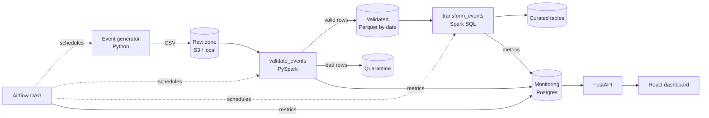

# DataOps Monitoring Platform

A daily data pipeline for synthetic e-commerce events, plus a monitoring dashboard that shows whether the data is fresh, which jobs failed and what quality problems were caught.

**Stack:** Python, PySpark, Spark SQL, Apache Airflow, FastAPI, React, Amazon S3, Docker, PostgreSQL



## What it does

1. **Ingest.** `pipeline/generate_events.py` creates millions of realistic events (page views, carts, checkouts, purchases) and lands them as CSV in Amazon S3 or a local folder. About 3% of rows are deliberately broken: missing users, negative prices, bad timestamps, duplicates.
2. **Validate.** `pipeline/validate_events.py` (PySpark) checks 8 quality rules, removes duplicates, sends bad rows to a quarantine table and records violation counts. If more than 10% of rows are bad, the task fails and the data is not promoted.
3. **Transform.** `pipeline/transform_events.py` (Spark SQL) builds daily sales by category, a conversion funnel and the top 10 products.
4. **Orchestrate.** An Airflow DAG runs the three steps every day with retries. Callbacks record every task attempt.
5. **Monitor.** A FastAPI service and React dashboard show data freshness against an SLA, failed and running jobs, quality violations and benchmark results.

## Performance

`pipeline/benchmark.py` runs the same pipeline twice on the same data:

| | Baseline | Optimized |
|---|---|---|
| Schema | inferred (extra pass over the data) | explicit |
| Caching | none, data re-read for every action | cached DataFrames reused |
| Shuffle partitions | 200 (Spark default), AQE off | 16, AQE on |
| Output layout | unpartitioned | partitioned by `event_date`, so reads skip other days |

Results on my machine with 5,000,000 events: **baseline _X_ min, optimized _Y_ min (_Z_% faster)**.
<!-- Replace X, Y, Z with the numbers printed by the benchmark. -->

## Run it

New to Docker, Airflow or Git? Follow the step-by-step [beginner's guide](docs/GUIDE.md).


Requirements: Docker Desktop with at least 6 GB of memory assigned.

```bash
cp .env.example .env
docker compose up -d --build
```

| Service | URL | Login |
|---|---|---|
| Airflow | http://localhost:8080 | airflow / airflow |
| Dashboard | http://localhost:3000 | |
| API docs | http://localhost:8000/docs | |

In Airflow, unpause `ecommerce_events_pipeline` and trigger it. Then open the dashboard.

Run the benchmark with 5M events:

```bash
docker compose exec airflow-scheduler python -m pipeline.generate_events --date 2026-10-06 --num-events 5000000
docker compose exec airflow-scheduler python -m pipeline.benchmark --run-date 2026-10-06
```

Run the tests:

```bash
docker compose exec airflow-scheduler python -m pytest /opt/airflow/tests -p no:cacheprovider
```

To use Amazon S3 instead of the local `data/` folder, see [docs/AWS_SETUP.md](docs/AWS_SETUP.md).

## Project layout

```
airflow/          Airflow image (adds Java + PySpark) and the DAG
pipeline/         Generator, Spark jobs, benchmark, monitoring DB helper
monitoring_db/    Postgres schema for monitoring tables
api/              FastAPI service + tests
dashboard/        React (Vite) dashboard served by nginx
tests/            PySpark tests for validation and transforms
docs/             Beginner guide and AWS setup
```
